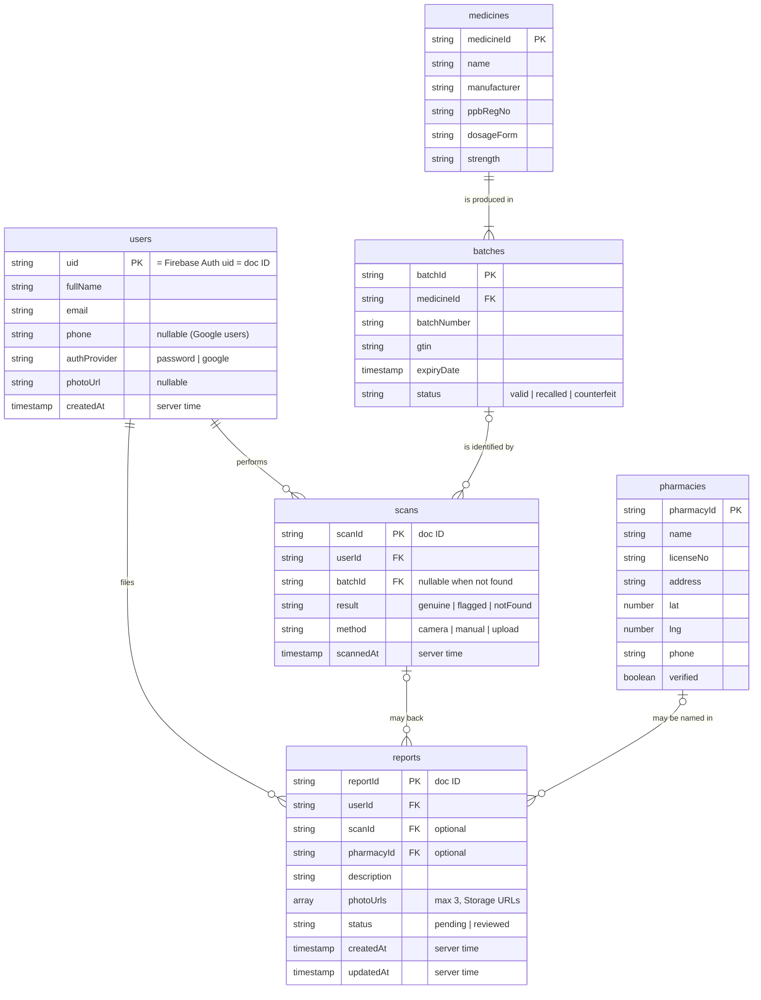

# Database design

Cloud Firestore, six top-level collections. This page is the source of truth
for the ERD: models, `firestore.rules` and the report use these exact names.
Shared constants for collection names and enum values live in
`lib/core/constants/firestore_schema.dart`.

## Entity-relationship diagram

## Design decisions

- **Reference vs personal data.** `medicines`, `batches` and `pharmacies` are
  reference data owned by the regulator. They are seeded with the Admin SDK
  (`backend/seed/`) and are read-only to the app. `users`, `scans` and
  `reports` belong to one user each.
- **No duplicated data.** A scan stores only `batchId`. The medicine name,
  manufacturer and expiry are read through `batches` → `medicines`, so a
  recall updates every past scan's display at once.
- **Server timestamps.** `createdAt`, `scannedAt` and `updatedAt` are written
  with `FieldValue.serverTimestamp()`, and the rules reject client-made dates.
  They are `null` in the first local snapshot, so every `fromJson` handles null.
- **Composite index** (`firestore.indexes.json`) backs history:
  `scans (userId ASC, scannedAt DESC)`. Reports are sorted client-side so
  legacy documents without `createdAt` remain visible.
- **Photos** live in Cloud Storage at `reports/{uid}/{reportId}/{file}` and
  `users/{uid}/avatar/{file}`. Firestore stores only their download URLs.

## Security rules

`firestore.rules` and `storage.rules` deny everything by default and open only
what each screen needs.

| Collection | Read | Create | Update | Delete |
|---|---|---|---|---|
| `users` | owner | owner, with `uid` = doc ID | owner; `uid`, `email`, `authProvider`, `createdAt` fixed | owner |
| `medicines`, `batches`, `pharmacies` | any signed-in user | never | never | never |
| `scans` | owner | owner, valid enums, server `scannedAt` | never (a scan is a log) | owner |
| `reports` | owner | owner, `status` = `pending`, ≤ 3 photos | owner, only while `pending`, must bump `updatedAt` | owner, only while `pending` |

How they protect data:

1. **Ownership comes from the token.** `request.auth.uid` must equal the doc's
   `userId` (or the `users` doc ID). A client can't read or write another
   user's data by sending a different ID.
2. **Exact shape.** Each write must contain exactly the ERD fields
   (`hasOnly` / `hasAll`), with correct types, lengths and enum values. Extra
   fields such as `isAdmin` are rejected.
3. **Immutable history.** Scans can't be edited. Identity fields and
   `createdAt` can't change, and a report can't be marked `reviewed` from the
   app.
4. **List queries are scoped.** A history or reports query only succeeds when
   filtered by `userId == request.auth.uid`.
5. **Storage** allows each user to read and write only under their own uid,
   and only images under 5 MB.

The rules are tested in the Firebase emulator (`backend/test/`, 26 cases),
both locally and in CI.
